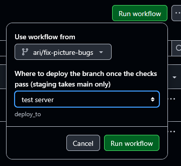

# Using the test server

The test server, [test.shahebbazar.com](https://test.shahebbazar.com), lets you try any branch on a
real server before it merges. Nothing reaches it unless someone puts a branch there by hand.

## What the test server is

| | Test server | Staging |
| --- | --- | --- |
| Address | [test.shahebbazar.com](https://test.shahebbazar.com) | [staging.shahebbazar.com](https://staging.shahebbazar.com) |
| Runs on | Our AWS server ([DEPLOY.md](DEPLOY.md)) | The client's server ([DEPLOY-CLIENT.md](DEPLOY-CLIENT.md)) |
| What it runs | Whichever branch was last deployed | Always the latest `main` |
| How it updates | By hand: Run workflow (below) | By itself, after every merge to `main` |
| Use it for | Trying a branch before review, showing a fix to testers | Checking what is merged, client demos |

Both show a **Test site** strip at the top, hold demo data only, and are hidden from search engines.
Campaign emails land in the test inbox at `/mail` instead of being sent. For the sign-in code and the
inbox password, ask Ari: they are never written in the repository.

## Put your branch on the test server

It takes about 5 to 10 minutes, most of it the checks running.

1. Push your branch to GitHub. Only branches on GitHub can be deployed.
2. In the repository, open **Actions** → **CI** (in the list on the left).
3. Click **Run workflow** (top right of the run list).
4. Under **Use workflow from**, pick your branch.
5. Under **Where to deploy**, leave **test server**.
6. Click the green **Run workflow** button in the box.



The API tests, frontend checks and browser tests run on your branch first. Only if all three pass does
**Deploy to the test server** start, so a broken branch never replaces what is there.

## Check it worked

It worked when the **Deploy to the test server** job's log ends with:

```
Deployed 6ab637c and the site is answering at https://test.shahebbazar.com
```

The code after **Deployed** is the commit now on the server; check it matches the latest commit on
your branch.

- A `curl: (22) The requested URL returned error: 502` line just before it is normal. The script
  checks the site while it is still starting, and keeps trying until it answers.
- The job shows as skipped if **staging** was picked, or if the checks failed.
- Then open [test.shahebbazar.com](https://test.shahebbazar.com) and try your change. Hard-refresh
  (Ctrl+Shift+R) if you still see the old version.

## Things to know

- **One branch at a time.** The server runs whatever was deployed last, so your deploy replaces
  someone else's. Say in the team chat before you deploy, and put `main` back when you are done if
  others need it.
- **Your test data stays between deploys.** Accounts, reviews and photos you add are still there
  after the next deploy.
- **Database changes stick.** If your branch adds a file in `database/migrations/`, it is applied
  when you deploy. Deploying another branch afterwards does not undo it. If the site misbehaves after
  switching branches, ask Ari to reset the demo data, which deletes everything added since.
- **Staging is not for branches.** The **staging** choice only redeploys `main` to staging. Picked on
  any other branch, nothing deploys. Merges to `main` update staging by themselves.

## If something goes wrong

| What you see | Why | What to do |
| --- | --- | --- |
| Your branch isn't in the **Use workflow from** list | It isn't on GitHub yet | Push it, then reload the page |
| API tests, Frontend checks or Browser tests failed; the deploy is skipped | Your branch breaks a test | Fix it as you would for a pull request ([TESTING.md](TESTING.md)), push, run again |
| The deploy job waits or says the branch can't deploy to `test-server` | The environment only allows some branches | Ask a repository admin to allow it |
| `… isn't on any branch of origin, so it isn't deployed.` | The commit isn't pushed, or the branch was deleted | Push the branch and run again |
| `The site isn't answering after the update.` | The new version doesn't start on the server | Send Ari the run's link; deploy `main` to get the site back meanwhile |
| A notice that the test server's secrets aren't set | The server's access is missing in GitHub | Tell Ari; nothing was deployed |

For anything else, send Ari the link to the run. Server setup and the deploy script are described in
[DEPLOY.md](DEPLOY.md), step 6.
